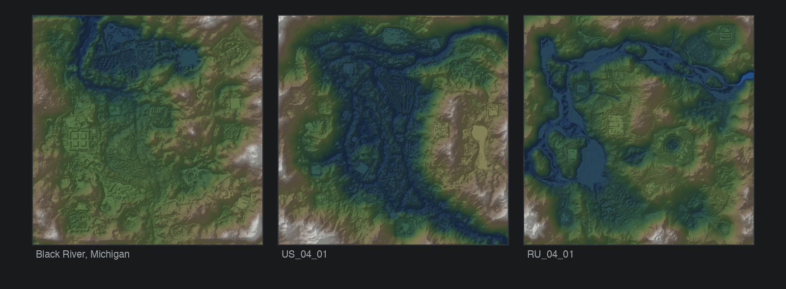
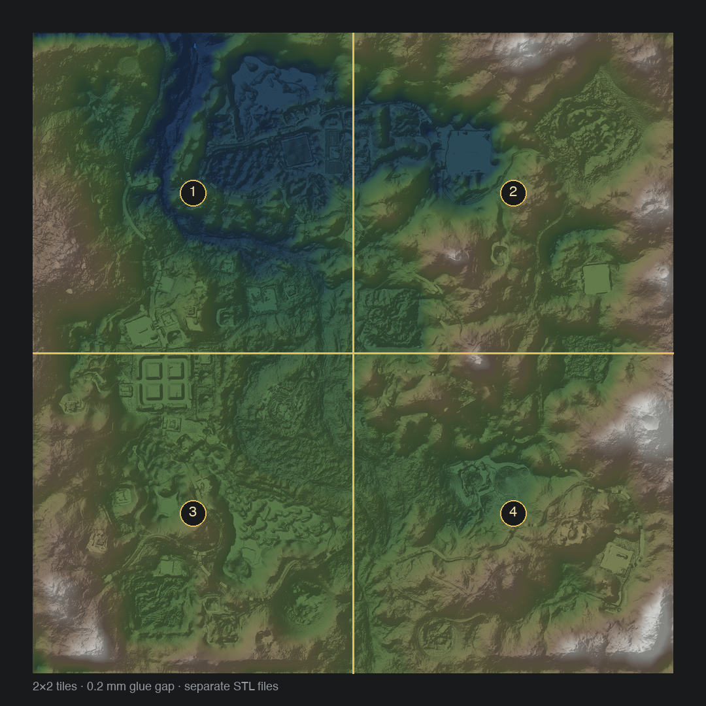

# SnowRunner Map Converter


Converts SnowRunner level paks into GLB, glTF, OBJ, PLY, STL, PNG and JSON.

Full documentation:

- [Русская документация](README.ru.md)
- [English documentation](README.en.md)

## What it does

- Extracts the terrain heightmap from `*_height_map.pct`.
- Builds the water surface from `*_water_height_map.pct`.
- Reads object placements from `data_for_ssl.bin`.
- Loads object meshes from `shared.pak` and textures from `editor.pak`.
- Converts the level to a normal 3D format or a 3D-printable STL.
- Splits print models into tiles with a configurable glue gap.

## Requirements

- Python 3.10+
- `numpy`
- `Pillow` for object textures

```bash
python3 -m pip install -r requirements.txt
```

For the full scene you need:

- `level_*.pak` — the level;
- `shared.pak` — object meshes;
- `editor.pak` — object textures.

All paks must be from the same game version. `shared.pak` and `editor.pak` are searched next to the level, or can be passed with `--shared-pak` and `--editor-pak`.

Prebuilt Windows, Linux and macOS binaries are published in Releases.

## Quick start

```bash
python3 snowrunner_map_converter.py level_us_01_01.pak -f glb
```

With `shared.pak` next to the level, trees, rocks, buildings and other static objects are added automatically.

Terrain and water only:

```bash
python3 snowrunner_map_converter.py level_us_01_01.pak -f glb --terrain-only
```

Check the environment:

```bash
python3 snowrunner_map_converter.py --check
```

List archive contents:

```bash
python3 snowrunner_map_converter.py level_us_01_01.pak --list
```

Without `-f`, the script asks for a format. On first run it asks for a language.

## 3D printing

Solid terrain with a flat base at `Z=0`, in millimeters:

```bash
python3 snowrunner_map_converter.py level_us_01_01.pak --print -o map_print.stl
```

Default print quality is `balanced`: 2 m terrain step, trees replaced with simple print proxies. `--print-quality high` and `max` use full meshes and produce much larger files. `--print-no-objects` gives a watertight terrain-only model.

Split the model into tiles:

```bash
python3 snowrunner_map_converter.py level_us_01_01.pak --print --split 2x2 -o map_print.stl
```

This produces `map_print_r1c1.stl` … `map_print_r2c2.stl` and `map_print_tiles.json`. The default gap is 0.2 mm; change it with `--split-gap`.

## Formats

| Format | Contents |
|---|---|
| `glb` | terrain, water, objects, materials and textures |
| `gltf` | same, separate `.gltf` + `.bin` |
| `obj` | terrain and water, `.obj` + `.mtl` |
| `ply` | terrain and water, binary PLY |
| `stl` | terrain and water, or a print model with `--print` |
| `png` | 16-bit heightmap |
| `raw` | raw `uint16` heights + JSON |
| `json` | metadata and extracted objects |

## Screenshots

Three tested maps:



Splitting a print model into 2×2 tiles:



## Build

```bash
python3 -m pip install -r requirements.txt -r requirements-dev.txt
python -m PyInstaller --onefile --name snowrunner-map-converter \
  --hidden-import sr_mesh --hidden-import sr_objects \
  --hidden-import sr_textures --hidden-import sr_gltf \
  --hidden-import sr_print --hidden-import sr_split \
  --hidden-import sr_i18n snowrunner_map_converter.py
```

GitHub Actions builds binaries on push. A `v*` tag publishes the archives to Releases.

## Limitations

- Grass and small foliage from `data.stg` distributions are not imported.
- Physics, collision and gameplay zones are not exported.
- FBX is not written directly; import GLB or OBJ into Blender.
- OBJ and PLY do not support the instanced full scene.

## License

MIT. Game files are not included in the repository.
