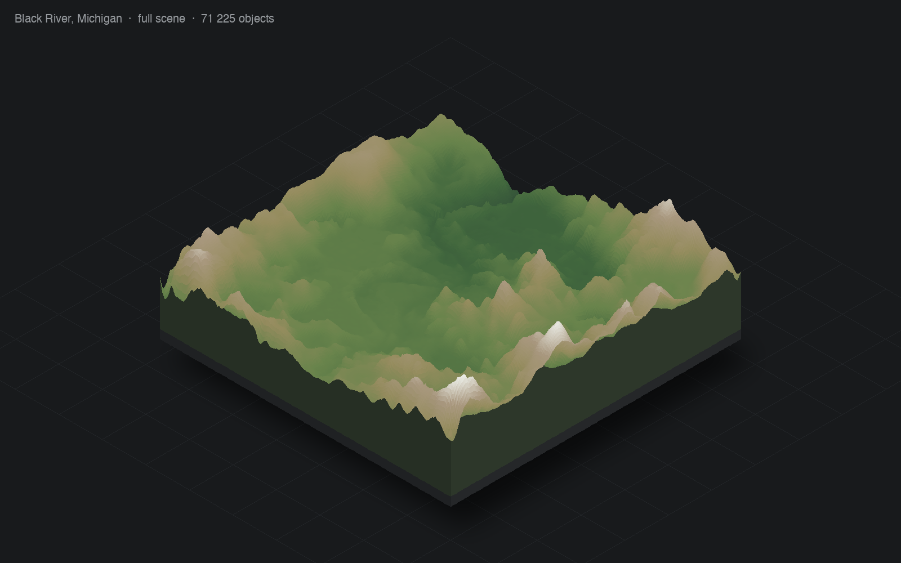

# SnowRunner Map Converter



Конвертер уровней SnowRunner в GLB, glTF, OBJ, PLY, STL, PNG и JSON.

## Требования

- Python 3.10+
- `numpy`
- `Pillow` (нужен для текстур объектов из `editor.pak`)

```bash
python3 -m pip install -r requirements.txt
```

Для полной сцены нужны:

- `level_*.pak` — уровень;
- `shared.pak` — меши объектов;
- `editor.pak` — текстуры объектов.

Все pak-файлы должны быть от одной версии игры. `shared.pak` и `editor.pak` ищутся рядом с уровнем или задаются через `--shared-pak` / `--editor-pak`.

Готовые бинарники: раздел Releases.

Скрипт показывает прогресс в терминале: спиннеры для коротких операций и прогресс-бары для объектов/текстур/плиток. Для логов и CI есть `--no-tui`.

## Где лежат pak-файлы

Нужны три типа файлов:

- `level_*.pak` — сам уровень, обязателен;
- `shared.pak` — меши объектов, нужен для полной сцены;
- `editor.pak` — текстуры объектов, нужен для текстур.

Обычно они лежат в папке игры:

```
Windows (Steam): C:\Program Files (x86)\Steam\steamapps\common\SnowRunner\preload\paks\
Windows (Epic):  C:\Program Files\Epic Games\SnowRunner\preload\paks\
macOS (Steam):   ~/Library/Application Support/Steam/steamapps/common/SnowRunner/preload/paks/
Linux (Proton):  ~/.steam/steam/steamapps/common/SnowRunner/preload/paks/
```

Уровни могут быть в подпапке `levels`. Скопируйте нужный `level_*.pak`, `shared.pak` и `editor.pak` в одну папку или укажите пути через `--shared-pak` и `--editor-pak`.

Полная справка:

```bash
python3 snowrunner_map_converter.py --where-paks
```

## Запуск

```bash
python3 snowrunner_map_converter.py level_us_01_01.pak -f glb
```

Если `shared.pak` лежит рядом, объекты добавляются автоматически.

Только рельеф и вода:

```bash
python3 snowrunner_map_converter.py level_us_01_01.pak -f glb --terrain-only
```

Проверка окружения:

```bash
python3 snowrunner_map_converter.py --check
```

Содержимое архивов:

```bash
python3 snowrunner_map_converter.py level_us_01_01.pak --list
```

Без `-f` скрипт спрашивает формат. При первом запуске спрашивает язык.

## Язык

```bash
python3 snowrunner_map_converter.py --lang ru ...
python3 snowrunner_map_converter.py --lang en ...
python3 snowrunner_map_converter.py --reset-config ...
```

Конфиг:

- macOS: `~/Library/Application Support/SnowRunnerMapConverter/config.json`
- Windows: `%APPDATA%\SnowRunnerMapConverter\config.json`
- Linux: `~/.config/SnowRunnerMapConverter/config.json`

## Форматы

| Формат | Содержимое |
|---|---|
| `glb` | рельеф, вода, объекты, материалы, текстуры |
| `gltf` | то же, отдельно `.gltf` + `.bin` |
| `obj` | рельеф и вода, `.obj` + `.mtl` |
| `ply` | рельеф и вода, бинарный PLY |
| `stl` | рельеф и вода, или печатная модель с `--print` |
| `png` | 16-битная карта высот |
| `raw` | сырые `uint16` + JSON |
| `json` | метаданные и объекты |

## 3D-печать

```bash
python3 snowrunner_map_converter.py level_us_01_01.pak --print -o map_print.stl
```

Модель: рельеф, экструдированный до плоского основания `Z=0`, без постамента. Единицы — миллиметры.

Параметры:

```
--print-width 200       ширина модели, мм
--base-thickness 3      толщина основания под низким рельефом, мм
--print-quality ...     balanced (по умолчанию), draft, high, max
--print-no-objects      только рельеф, без объектов
--print-full-objects    полные меши деревьев в balanced/draft
```

`balanced` заменяет деревья и кусты на простые печатные прокси. `high` и `max` используют полные меши и дают большие файлы.

## Разрезка

```bash
python3 snowrunner_map_converter.py level_us_01_01.pak --print --split 2x2 -o map_print.stl
```

Результат: `map_print_r1c1.stl` … `map_print_r2c2.stl` и `map_print_tiles.json`.

- `--split 2x2` — 2 колонки × 2 ряда; поддерживаются `3x3`, `3x2` и т.д.
- `--split-gap 0.2` — зазор между плитками, мм.
- Плитки с `--print-no-objects` герметичны; с объектами содержат отдельные оболочки, которые объединяет слайсер.

## Ограничения

- Трава и мелкая растительность из `data.stg` (`grass_*`, `leaves_*`, `debris_*`) не импортируются.
- Физика, коллизии и игровые зоны не экспортируются.
- FBX напрямую не пишется; используйте Blender.
- OBJ и PLY не поддерживают полную сцену с инстансами.

## Сборка

```bash
python3 -m pip install -r requirements.txt -r requirements-dev.txt
pyinstaller --onefile --name snowrunner-map-converter \
  --hidden-import sr_mesh --hidden-import sr_objects \
  --hidden-import sr_textures --hidden-import sr_gltf \
  --hidden-import sr_print --hidden-import sr_split \
  --hidden-import sr_i18n --hidden-import sr_tui snowrunner_map_converter.py
```

GitHub Actions собирает Windows, Linux и macOS при пуше. Тег `v*` публикует архивы в Releases.

## Лицензия

MIT. Файлы игры в репозиторий не входят.
